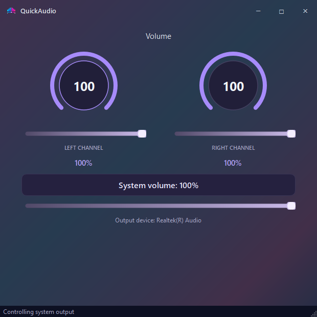

# QuickAudio

- Do you frequently change the volume of the left and right audio channels on your PC for whatever reason?<br><br>
- Do you want the app that changes said volume to NOT use about 20% of your CPU at idle and 100MB of ram because Microsoft sucks?<br><br>
- Do you not care about code whipped up in 10 minutes using an LLM and probably no further updates? <br>

### Then this is the application for you!



## Features

- Adjust each available output channel using its dial or slider.
- Select an output device and adjust its master volume.
- Follow changes to output devices and their volume automatically.

## Getting started

Download the Windows x64 installer from the project's GitHub releases, or extract
the ZIP and run `QuickAudio.exe`. The ZIP includes the Qt runtime dependencies;
the Microsoft Visual C++ Redistributable may also be required.

Drag a dial up or down, or use its slider, to change a channel's volume. Use the
system volume slider to change the master volume. Select an output device using
the device selector. To change the Windows default output for all audio roles,
select a device and click Set selected device as default. Controls are unavailable when
the corresponding device or channel is unavailable.

## Build from source

Install CMake 4.4 or newer, a C++26-capable MSVC toolchain, and Qt 6 with Core,
Gui, and Widgets. From a developer command prompt, configure with your Qt
installation path and build:

```powershell
cmake -S . -B build -G Ninja -DCMAKE_BUILD_TYPE=Release "-DCMAKE_PREFIX_PATH=C:/Qt/6.12.0/msvc2022_64"
cmake --build build
ctest --test-dir build --output-on-failure
```

Replace the Qt path with your installation and install Ninja if necessary.

## CI and releases

GitHub Actions builds and tests on pushes and pull requests and uploads the
Windows x64 ZIP and installer as workflow artifacts. Pushing a tag beginning
with `v` (for example, `v1.0.0`) publishes both as a GitHub release after the
build and tests pass. The repository must allow GitHub Actions to create releases.
